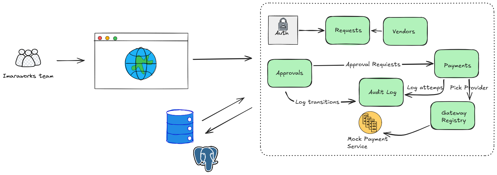

[](https://coveralls.io/github/imaraworks-team/Imaraworks)

# ImaraWorks Vendor Payment & Approval System

A Django REST API for submitting, approving, paying and reporting vendor payment requests. KamiLimu ICT Track case study.



## Quick start

```
python -m venv venv
venv\Scripts\Activate.ps1        # Windows; macOS/Linux: source venv/bin/activate
pip install -r requirements.txt  # re-run after every pull that changes requirements.txt
python manage.py migrate
python manage.py seed_users
python manage.py runserver
```

Tests: `python manage.py test`.

## Test accounts (local password: `password123`)

| Username | Role |
|---|---|
| alice, brian | Employee |
| carol, david | Manager |
| faith, fiona | Finance Officer |
| grace | Administrator |

## Contributors

| Name | GitHub | Area |
|---|---|---|
| Tamira Atieno | [@TamiraAtieno1](https://github.com/TamiraAtieno1) | Accounts, vendors and payment requests |
| Joylynn Wamjiru | [@JoylynnWamjiru](https://github.com/JoylynnWamjiru) | Approvals, audit, reporting, settings and CI |
| Lewis Gitau | [@codingwithgitau](https://github.com/codingwithgitau) | Frontend |
| Isaac Mwangi | [@B1t-Master](https://github.com/B1t-Master) | Payments (mock provider) and DevOps |

## Documentation

- [docs/API.md](docs/API.md) — endpoints, approval workflow, payments, reports, errors, conventions (and how to use `/admin/`, `/api-auth/`, headers/body)
- [docs/ARCHITECTURE.md](docs/ARCHITECTURE.md) — system architecture, settings, security, health checks, deployment/Docker, CI
- [docs/RUNNING_IT_ON_YOUR_MACHINE.md](docs/RUNNING_IT_ON_YOUR_MACHINE.md) — local setup, Docker, admin/browsable API, headers and body inspection
