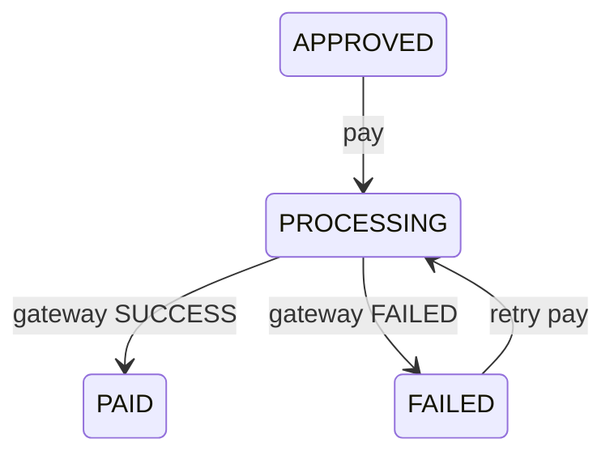

# API reference

Conventions:

- JSON everywhere. Send `Authorization: Bearer <access token>` on every call except login, refresh and health.
- Errors are `{"detail": "..."}`; field validation errors are `{"field": ["message", ...]}`.
- Lists are plain arrays (no pagination). Timestamps are UTC. Amounts are 2-decimal **strings** — don't do float arithmetic on them.
- Access tokens last about 5 minutes, so expect the 401 → refresh → retry flow often.
- Roles: `EMPLOYEE`, `MANAGER`, `FINANCE`, `ADMIN`. A `null` role means no access (treat it as no role).
- **Try it yourself:** use the Django admin at `/admin/` or DRF's browsable API at `/api-auth/login/` (you can log in with a test account or your own user). For JSON clients send `Authorization: Bearer <access token>` (from `/api/auth/login/`) with `Content-Type: application/json`; to see headers/body clearly use your browser devtools/network tab or `curl -v`. The browsable API shows the request form, headers and rendered response bodies.

## Endpoints at a glance

| Method | Path | Who | Purpose |
|---|---|---|---|
| GET | /health/ | Anyone | Liveness check, no auth, no database |
| GET | /ready/ | Anyone | Readiness: 200 when the database is reachable, 503 otherwise |
| GET | /api/health/ | Anyone | Older alias of /health/ |
| POST | /api/auth/login/ | Anyone | Get access + refresh tokens |
| POST | /api/auth/refresh/ | Anyone | Exchange a refresh token for a new access token |
| GET | /api/auth/me/ | Any logged-in user | Your profile and role |
| GET | /api/vendors/ | Any logged-in user | Active vendors |
| GET | /api/projects/ | Any logged-in user | Projects |
| GET, POST | /api/payment-requests/ | See "Who sees what" | List / create payment requests |
| GET | /api/payment-requests/<id>/ | See "Who sees what" | One request |
| POST | /api/payment-requests/<id>/submit/ | The request's requester | Send a draft for approval |
| GET | /api/approvals/queue/ | MANAGER, FINANCE | Requests waiting on my decision |
| POST | /api/payment-requests/<id>/approve/ | MANAGER, FINANCE | Approve at my level |
| POST | /api/payment-requests/<id>/reject/ | MANAGER, FINANCE | Reject with a reason |
| PATCH | /api/payment-requests/<id>/amount/ | The request's requester | Change the amount (resets approvals) |
| GET | /api/payment-requests/<id>/history/ | Whoever can see the request | Audit trail of one request |
| GET | /api/audit/ | ADMIN | Whole audit log (redacted) |
| POST | /api/payment-requests/<id>/pay/ | FINANCE | Charge an approved request via the gateway |
| GET | /api/payments/transactions/ | FINANCE | Every payment attempt |
| GET | /api/reports/summary/ | EMPLOYEE, MANAGER, FINANCE | Totals (optional filters) |

## Auth

### POST /api/auth/login/
```json
{"username": "carol", "password": "password123"}
```
200: `{"access": "...", "refresh": "..."}`
401: `{"detail": "No active account found with the given credentials"}`

### POST /api/auth/refresh/
```json
{"refresh": "..."}
```
200: `{"access": "..."}`
401: `{"detail": "Token is invalid or expired", "code": "token_not_valid"}`

### GET /api/auth/me/
```json
{"id": 1, "username": "carol", "first_name": "Carol", "last_name": "Wanjiku", "role": "MANAGER"}
```
`role` is one of `EMPLOYEE`, `MANAGER`, `FINANCE`, `ADMIN`, or `null` for a user with no profile (for example a superuser).

### GET /health/ and /api/health/
No auth. Liveness only — the process is up and can answer; no database access. `200: {"status": "ok"}`. `/health/` is the root-level path the host uses; `/api/health/` is the older alias.

### GET /ready/
No auth. Readiness: runs `SELECT 1` against the database. `200: {"status": "ok"}`, or `503: {"status": "unavailable"}` when the database is unreachable. The host uses this to decide when to send traffic.

## Reference data

Any logged-in role. Plain arrays, no pagination.

### GET /api/vendors/
Active vendors only, sorted by name.
```json
[{"id": 1, "name": "Metro Hardware Ltd.", "service": "Construction materials"}]
```

### GET /api/projects/
Sorted by name.
```json
[{"id": 1, "name": "Westlands Project"}]
```

## Payment requests

| Method | Path | Purpose |
|---|---|---|
| GET | /api/payment-requests/ | List, newest first (plain array) |
| POST | /api/payment-requests/ | Create |
| GET | /api/payment-requests/<id>/ | One request |
| POST | /api/payment-requests/<id>/submit/ | Send a draft for approval |
| PATCH | /api/payment-requests/<id>/amount/ | Change the amount (resets approvals) |
| GET | /api/payment-requests/<id>/history/ | Audit trail of one request |

There is no edit endpoint other than the amount change.

### POST body
```json
{
  "vendor": 1,
  "project": 1,
  "amount": "24500.00",
  "reason": "Site materials",
  "invoice_number": "INV-1032",
  "payment_method": "MPESA",
  "date": "2026-10-14",
  "notes": ""
}
```
- `vendor` and `project` are ids from the reference endpoints.
- `amount` must be greater than 0.
- `reason` max 500 characters. `invoice_number` required, max 100 characters, trimmed.
- `payment_method` is `MPESA`, `BANK_TRANSFER` or `CASH`.
- `date` is the invoice date (`YYYY-MM-DD`). It is not when the request was created. Use `created_at` for that.
- Do **not** send `requester` or `status`. The server sets them (requester is the logged-in user, status is `DRAFT`). If sent, they are ignored.

### Response (201 on create, 200 on get)
```json
{
  "id": 1,
  "vendor": 1, "vendor_name": "Metro Hardware Ltd.",
  "project": 1, "project_name": "Westlands Project",
  "requester": 1, "requester_username": "alice", "requester_name": "Alice Mwangi",
  "amount": "24500.00",
  "reason": "Site materials",
  "invoice_number": "INV-1032",
  "payment_method": "MPESA",
  "date": "2026-10-14",
  "notes": "",
  "status": "DRAFT",
  "created_at": "2026-10-14T01:00:00Z",
  "submitted_at": null,
  "updated_at": "2026-10-14T01:00:00Z",
  "approval": {"required_levels": ["manager"], "approved_levels": [], "outstanding_levels": []}
}
```
- `requester_name` is the full name, or the username if the user has no name set.
- `approval` shows which approval levels are needed, done and still outstanding. See [Approval rules and workflow](#approval-rules-and-workflow).
- `amount` is a string, not a number. Format it for display and don't do arithmetic on it directly.
- `submitted_at` is when the request last went into `PENDING_APPROVAL`: set on submit, and set again when an amount change sends it back for approval. It's `null` for drafts. Count "waiting" times from this, not from `created_at`, so time spent as a draft doesn't count. Read-only; if sent, it is ignored.
- Timestamps are UTC.
- `status` values: `DRAFT`, `SUBMITTED`, `PENDING_APPROVAL`, `APPROVED`, `REJECTED`, `PROCESSING`, `PAID`, `FAILED`.

### Who sees what
| Role | List and view | Create |
|---|---|---|
| EMPLOYEE | Own requests only | Yes |
| MANAGER | All requests | Yes |
| FINANCE | All requests | Yes |
| ADMIN | None (deliberate: admins manage users, not payments) | No (403) |

## Approval rules and workflow

Part of the API contract (see also `apps/approvals/`).

### Rules (enforced by the server)
- **≤ KES 50,000** needs one `manager` approval. **> KES 50,000** needs `manager` **and** `finance`, in either order.
- A new request starts as `DRAFT`. Its requester submits it, which moves it straight to `PENDING_APPROVAL`; no request is left showing `SUBMITTED`.
- Only requests in `PENDING_APPROVAL` can be approved or rejected.
- **Nobody can approve or reject a request they created.**
- One rejection at any level ends the request (`REJECTED`). A reason is required.
- If the amount changes after approval, earlier approvals stop counting and the request goes back to `PENDING_APPROVAL`. The levels are recalculated from the new amount.
- Levels are lowercase: `manager`, `finance`. A MANAGER approves as `manager`, a FINANCE officer as `finance`. EMPLOYEE and ADMIN users can't approve.

### The `approval` block
The queue, the submit and amount-change responses, the approve/reject responses, and `GET /api/payment-requests/` (list and detail) include this block:

```json
"approval": {
  "required_levels": ["finance", "manager"],
  "approved_levels": ["manager"],
  "outstanding_levels": ["finance"]
}
```
- `outstanding_levels` only lists levels while the request is `PENDING_APPROVAL`. It is empty once fully approved, and for every other status (a draft isn't waiting on anyone yet; a rejected or paid request never will). `required_levels` is shown for every status.

### POST /api/payment-requests/<id>/submit/
No body. Only the person who created the request can submit it, whatever their role (managers and finance raise requests too). `DRAFT` goes straight to `PENDING_APPROVAL`, and a `SUBMITTED` entry is added to the request's history.

200: the full request with `approval` (as above).
Errors (checked in this order):
| Status | `detail` | When |
|---|---|---|
| 404 | `Not found.` | No such request, or you can't see it (another employee's request, or any ADMIN) |
| 403 | `Only the person who created this request can submit it.` | You can see it but didn't create it |
| 409 | `This request has already been submitted.` | Status isn't `DRAFT` (or a leftover `SUBMITTED`) |

### GET /api/approvals/queue/
Requests the current user can act on right now. The request is `PENDING_APPROVAL`, needs the user's level, hasn't been approved at that level yet, and wasn't created by the user. Oldest first, plain array. Each item has the same fields as `GET /api/payment-requests/<id>/` plus `approval`.
```json
[{
  "id": 7, "vendor_name": "SwiftHaul Logistics", "requester_username": "alice",
  "amount": "67000.00", "status": "PENDING_APPROVAL", "created_at": "...", "submitted_at": "...",
  "approval": {"required_levels": ["finance", "manager"], "approved_levels": [], "outstanding_levels": ["finance", "manager"]}
}]
```
For a "waiting since" column, use `submitted_at` (see [API.md](API.md)). EMPLOYEE and ADMIN users get `403`.

### POST /api/payment-requests/<id>/approve/
No body. 200: full request/`approval` with `status` becoming `APPROVED` once `outstanding_levels` is empty, else `PENDING_APPROVAL`.

### POST /api/payment-requests/<id>/reject/
```json
{"reason": "Invoice does not match the delivery note"}
```
Leading/trailing spaces trimmed. A blank reason gives `400`. 200: request with `status` `REJECTED`, `reason`, and empty `approval`.

### Approve / reject errors (checked in order)
| Status | `detail` | When |
|---|---|---|
| 404 | `Not found.` | No such request, or you can't see it (this includes every ADMIN, since admins see no requests) |
| 403 | `Your role cannot approve payments.` | EMPLOYEE, on their own request |
| 409 | `This request is not awaiting approval.` | Status isn't `PENDING_APPROVAL` |
| 403 | `You cannot approve a request you created.` | Self-approval (applies to reject too) |
| 403 | `Your approval is not required for this request.` | e.g. FINANCE on a request ≤ 50k |
| 409 | `This level has already approved.` | Your level has already approved |
| 400 | `A reason is required to reject a request.` | Reject only, blank reason |

`403` means "not you", `409` means "not now" (the request's state changed, so reload it), and `400` means "fix your input".

### PATCH /api/payment-requests/<id>/amount/
```json
{"amount": "67000.00"}
```
Only the person who created the request can change its amount, whatever their role. An approver can't change the number they approved.

| Status before | What happens |
|---|---|
| `DRAFT`, `SUBMITTED` | Amount changes, status stays the same |
| `PENDING_APPROVAL`, `APPRODED?` wait — `APPROVED` | Amount changes, **every approval so far stops counting** (even for a decrease), status goes to `PENDING_APPROVAL`. The levels are recalculated from the new amount, so 42,000 → 67,000 now needs finance too. |
| anything else | `409`, the amount is locked |

Sending the amount it already has changes nothing and writes no history entry.

Errors (checked in order): 404 (no such request or can't see it; another employee's request or any ADMIN), 400 (missing/not number/≤0/2dp/too large), 403 (can see but didn't create), 409 (locked for this status).

A bad body is a `400` whoever sends it: it says nothing about the request.

### GET /api/payment-requests/<id>/history/
You can see a request's history exactly when you can see the request (see "Who sees what"). Anyone else gets `404`. Oldest first.
```json
[
  {"id": 1, "action": "CREATED", "actor_username": "alice", "details": {}, "timestamp": "..."},
  {"id": 4, "action": "APPROVED", "actor_username": "carol", "details": {"level": "manager", "amount": "67000", "fully_approved": false}, "timestamp": "..."}
]
```
- `action` is `CREATED`, `SUBMITTED`, `APPRODED`, `REJECTED`, `AMOUNT_CHANGED`, `PAYMENT_STARTED`, `PAID`, `PAYMENT_FAILED`.
- `details` depends on the action: `SUBMITTED` has `amount` and `required_levels`, `REJECTED` has `reason`, and `AMOUNT_CHANGED` has `old_amount`, `new_amount` and `retiered`.

### GET /api/audit/
ADMIN only, read-only. Admins can't see payment requests or payment data, so they see who did what and when, but not `details` (amounts, vendors, rejection reasons). Every other role gets `403`. Newest first.
```json
[
  {"id": 4, "action": "APPROVED", "actor_username": "carol", "timestamp": "...", "request": 12}
]
```
Optional filter: `?action=REJECTED`.

## Payments

### POST /api/payment-requests/<id>/pay/
FINANCE only. Pays an `APPROVED` request, or retries a `FAILED` one, through the mock provider. The amount charged is always the request's approved amount.

Body (all optional):
```json
{"idempotency_key": "a uuid", "currency": "KES", "gateway": "mock", "description": "..."}
```
- Send the same `idempotency_key` when retrying after a network error: you get the first attempt back (`"replayed": true`), not a second charge. One is generated if you leave it out.
- A `description` containing "FAIL" makes the mock provider decline (for demos).

Response (201 new attempt, 200 replay):
```json
{
  "id": 7, "request": 1, "status": "SUCCESS", "amount": "24500.00", "currency": "KES",
  "provider_reference": "MOCK-...", "provider_reason": "", "replayed": false,
  "created_at": "2026-10-20T08:00:00Z", "completed_at": "2026-10-20T08:00:01Z"
}
```
`status` is `SUCCESS` (request becomes `PAID`) or `FAILED` (request becomes `FAILED` and can be retried).

| Status | When |
|---|---|
| 403 | Not FINANCE, or the request is your own (`"You cannot pay a request you created."`) |
| 404 | No such request |
| 409 | Not payable (not `APPROVED`/`FAILED`), already paid, or a payment is in progress |
| 422 | `amount` was sent (it is never accepted), or unknown `gateway` |
| 502 | The provider errored; the attempt is recorded `FAILED` |

### GET /api/payments/transactions/
FINANCE only. Every payment attempt, newest first (plain array). Each item carries `id`, `request`, `request_vendor`, `request_amount`, `status`, `amount`, `currency`, `provider_reference`, `provider_reason`, `gateway`, `created_at` and `completed_at`.

## Reports

### GET /api/reports/summary/
Totals over the requests **you can see**, using the same rule as the request list ("Who sees what" above). Managers and finance get totals for everything; an employee gets totals for their own requests only. ADMIN gets `403` (`"Your role cannot view reports."`), for the same reason they see no requests. Read-only: other methods return 405.

```json
{
  "overall":          {"count": 4, "total": "281500.00"},
  "pending_approval": {"count": 2, "total": "215000.00"},
  "paid":             {"count": 1, "total": "24500.00"},
  "by_status": [
    {"status": "DRAFT", "label": "Draft", "count": 0, "total": "0.00"},
    {"status": "PENDING_APPROVAL", "label": "Pending Approval", "count": 2, "total": "215000.00"}
  ],
  "by_project": [{"id": 3, "name": "Kisumu Project", "count": 2, "total": "190000.00"}],
  "by_vendor":  [{"id": 2, "name": "Prime Cement Supplies", "count": 2, "total": "215000.00"}]
}
```

- `by_status` always lists **all 8 statuses** in lifecycle order (DRAFT … FAILED), with zeros for unused ones, so a dashboard always has the same rows.
- `by_project` and `by_vendor` list only those with at least one request, biggest total first.
- Amounts are 2dp **strings**, as everywhere else in this API, so nothing is rounded by a float.
- `total` adds up `amount` across requests in any status. Use `paid` for money actually paid out.

Optional filter: `?status=PAID` (any status value above, uppercase) narrows the requests **before** every total, so `by_project` and `by_vendor` show only paid money. The filter applies inside what you can already see, so an employee still gets only their own requests. With a filter, the `pending_approval` and `paid` blocks follow it too (e.g. `pending_approval` is zero under `?status=PAID`). An unknown value gives 400: `{"status": ["\"BOGUS\" is not a valid choice."]}`.

Optional date range: `?date_from=2026-10-01&date_to=2026-10-31` (YYYY-MM-DD, either one alone is fine) keeps requests whose `date` is in the range, **including both end days**. It combines with `?status=`. A badly formatted date gives 400 on that field, and `date_from` after `date_to` gives 400: `{"date_to": ["Must be on or after date_from."]}`.

Optional payment-date range: `?paid_from=2026-10-01&paid_to=2026-10-31` keeps requests whose **successful payment completed** in the range, so that example is "money paid out in October", whenever the request was raised. Use this, not `date_from`/`date_to`, for paid totals. Days are Kenyan days (EAT, UTC+3): a payment at 01:00 on 1 November in Nairobi counts in November. Failed payment attempts never count, so only paid requests can match, and each request is counted once. It combines with `?status=` and with `date_from`/`date_to`, with the same 400s (`{"paid_to": ["Must be on or after paid_from."]}`).

## Errors

| Status | Body | When |
|---|---|---|
| 400 | `{"amount": ["Amount must be greater than zero."]}` | Field validation. Keys are field names, values are lists of messages |
| 400 | `{"non_field_errors": ["The fields vendor, invoice_number must make a unique set."]}` | Same vendor and invoice number already exists |
| 401 | `{"detail": "Authentication credentials were not provided."}` | Missing or expired token |
| 403 | `{"detail": "Your role cannot create payment requests."}` | Role not allowed to create |
| 404 | `{"detail": "..."}` | Missing id, or another employee's request (same response for both) |

DRF generates the `detail` wording, so check one real response before relying on exact text. The shapes are reliable.

## Test users

Password for all: `password123` (local dev settings).
alice and brian (EMPLOYEE), carol and david (MANAGER), faith and fiona (FINANCE), grace (ADMIN).

## Mock payment provider

Code: `apps/payments/`. Endpoints: [API.md § Payments](API.md#payments).

The system charges payments through a pluggable gateway. Nothing real is charged: the default and currently only gateway is a mock.

## Three layers

| Layer | File | Responsibility |
|---|---|---|
| Gateway adapter | `gateways.py` | Abstract `PaymentGateway.charge(...) -> ChargeResult(reference, status, reason)` plus a name registry (`register_gateway` / `get_gateway`). Gateways are stateless: no idempotency, no database. |
| Service | `services.py` (`initiate_payment`) | All the safety rules: row locks, idempotency replay, double-pay and concurrency refusal, transaction boundaries, audit entries. The gateway is called **outside** the database transaction so no lock is held during an external call. |
| HTTP | `views.py` | FINANCE-only endpoints: `POST /api/payment-requests/<id>/pay/` and `GET /api/payments/transactions/`. |

## The mock gateway (`mock_gateway.py`)

- Registered as `"mock"` on app startup (`apps.py` → `ready()`); it is the default for every payment.
- No network calls, no state.
- **Succeeds unless `description` contains `FAIL` (case-insensitive)** — then it returns `FAILED` with reason `"Mock decline triggered by 'FAIL' in description"`. Handy for demos.
- On success the provider reference is `MOCK-<transaction id>`.
- If no description is sent, the service generates one: `Request #<id> - <vendor> - <reason>`.

## Transaction lifecycle

`PaymentTransaction` statuses: `PROCESSING` → `SUCCESS` | `FAILED` (nothing else).



- **DB constraints**: one `SUCCESS` transaction per request (never pay twice), and the idempotency key is unique per request.
- **Error order** in the service: replay of an existing key → already paid → payment already in flight → request not payable → self-payment. The view maps these to 200/403/409 as listed in API.md.
- **Self-payment is refused**: nobody can pay a request they created (separation of duties, same idea as approvals).
- **Gateway exception** → the attempt is committed as `FAILED` first, then the API answers `502`, so the request is never stranded in `PROCESSING`.
- Every attempt writes an audit entry: `PAYMENT_STARTED`, `PAID` or `PAYMENT_FAILED`.

## Idempotency

- The client may send `idempotency_key` (a uuid); the view generates one if omitted (double-click protection).
- The same key on the same request returns the original attempt with `"replayed": true` — no second charge.
- The charged amount is always the request's **approved amount**, read under the row lock. An `amount` field in the body is rejected with `422`.

## Adding a real provider (M-Pesa, bank, …)

Nothing outside `apps/payments/` changes:

1. Implement the interface — keep it stateless; raise on infrastructure errors (the service records `FAILED` and answers 502):

   ```python
   class MpesaGateway(PaymentGateway):
       def charge(self, *, amount, currency, reference, description, idempotency_key):
           # call the M-Pesa API here
           return ChargeResult(reference=checkout_id, status="SUCCESS")   # or
           # return ChargeResult(reference=checkout_id, status="FAILED", reason="...")
   ```

2. Register it: `register_gateway("mpesa", MpesaGateway)` (e.g. in `apps.py` `ready()`).
3. Store credentials in the existing `PaymentGatewayConfig` model (`name`, `is_active`, `config` JSON) — the mock doesn't use it, but a real provider should.
4. Call `POST /api/payment-requests/<id>/pay/` with `"gateway": "mpesa"` (unknown names give `422`).
