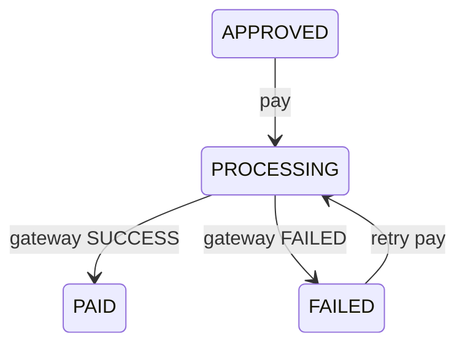

# Mock payment provider

Code: `apps/payments/`. Endpoints: [API.md § Payments](API.md#payments).

The system charges payments through a pluggable gateway. Nothing real is charged: the default and currently only gateway is a mock.

## Three layers

| Layer | File | Responsibility |
|---|---|---|
| Gateway adapter | `gateways.py` | Abstract `PaymentGateway.charge(...) -> ChargeResult(reference, status, reason)` plus a name registry (`register_gateway` / `get_gateway`). Gateways are stateless: no idempotency, no database. |
| Service | `services.py` (`initiate_payment`) | All the safety rules: row locks, idempotency replay, double-pay and concurrency refusal, transaction boundaries, audit entries. The gateway is called **outside** the database transaction so no lock is held during an external call. |
| HTTP | `views.py` | FINANCE-only endpoints: `POST /api/payment-requests/<id>/pay/` and `GET /api/payments/transactions/`. |

## The mock gateway (`mock_gateway.py`)

- Registered as `"mock"` on app startup (`apps.py` → `ready()`); it is the default for every payment.
- No network calls, no state.
- **Succeeds unless `description` contains `FAIL` (case-insensitive)** — then it returns `FAILED` with reason `"Mock decline triggered by 'FAIL' in description"`. Handy for demos.
- On success the provider reference is `MOCK-<transaction id>`.
- If no description is sent, the service generates one: `Request #<id> - <vendor> - <reason>`.

## Transaction lifecycle

`PaymentTransaction` statuses: `PROCESSING` → `SUCCESS` | `FAILED` (nothing else).



- **DB constraints**: one `SUCCESS` transaction per request (never pay twice), and the idempotency key is unique per request.
- **Error order** in the service: replay of an existing key → already paid → payment already in flight → request not payable → self-payment. The view maps these to 200/403/409 as listed in API.md.
- **Self-payment is refused**: nobody can pay a request they created (separation of duties, same idea as approvals).
- **Gateway exception** → the attempt is committed as `FAILED` first, then the API answers `502`, so the request is never stranded in `PROCESSING`.
- Every attempt writes an audit entry: `PAYMENT_STARTED`, `PAID` or `PAYMENT_FAILED`.

## Idempotency

- The client may send `idempotency_key` (a uuid); the view generates one if omitted (double-click protection).
- The same key on the same request returns the original attempt with `"replayed": true` — no second charge.
- The charged amount is always the request's **approved amount**, read under the row lock. An `amount` field in the body is rejected with `422`.

## Adding a real provider (M-Pesa, bank, …)

Nothing outside `apps/payments/` changes:

1. Implement the interface — keep it stateless; raise on infrastructure errors (the service records `FAILED` and answers 502):

   ```python
   class MpesaGateway(PaymentGateway):
       def charge(self, *, amount, currency, reference, description, idempotency_key):
           # call the M-Pesa API here
           return ChargeResult(reference=checkout_id, status="SUCCESS")   # or
           # return ChargeResult(reference=checkout_id, status="FAILED", reason="...")
   ```

2. Register it: `register_gateway("mpesa", MpesaGateway)` (e.g. in `apps.py` `ready()`).
3. Store credentials in the existing `PaymentGatewayConfig` model (`name`, `is_active`, `config` JSON) — the mock doesn't use it, but a real provider should.
4. Call `POST /api/payment-requests/<id>/pay/` with `"gateway": "mpesa"` (unknown names give `422`).
